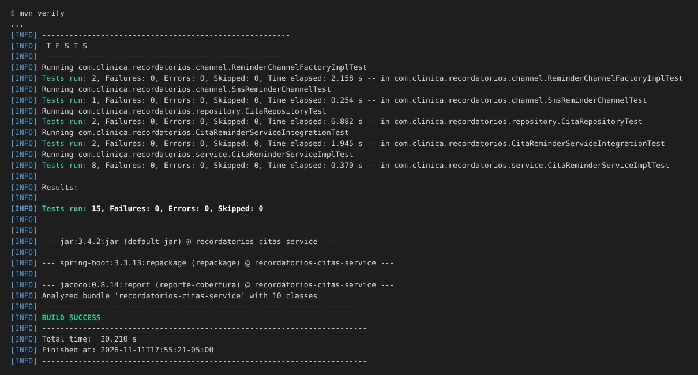
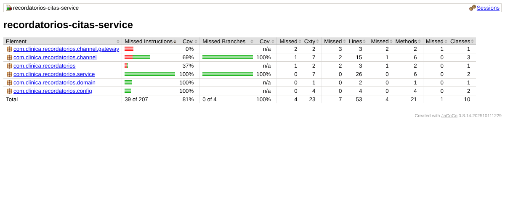
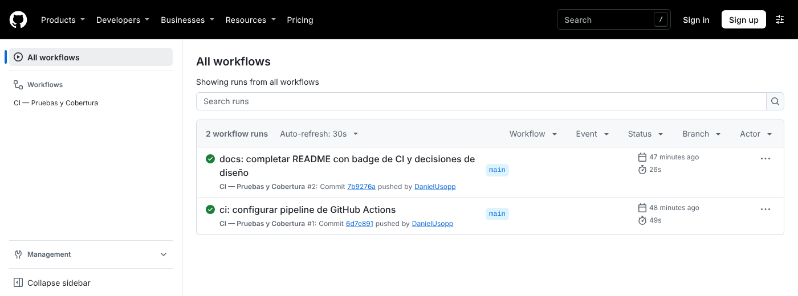

# Recordatorios Citas Service


## Descripción
Repositorio del post-contenido de la Unidad 9 de Patrones de Diseño de Software. Un único proyecto Spring Boot (`recordatorios-citas-service`) que busca las citas médicas de las próximas 24 horas que todavía no tienen recordatorio y lo envía por el canal que prefiere el paciente (correo o SMS). El canal de envío es una Strategy (`ReminderChannel`), la elección del canal es un Factory Method (`ReminderChannelFactory`) y ambos llegan a `CitaReminderServiceImpl` por constructor, junto con el repositorio y el `Clock`.

## Parte 1 — Pruebas unitarias con JUnit 5 y Mockito
`CitaReminderServiceImplTest` prueba el servicio sin levantar el contexto de Spring ni una base de datos. Además de las tres pruebas del enunciado se agregaron dos escenarios: dos citas con canales distintos en la misma ejecución y el texto exacto del mensaje que recibe el canal. `SmsReminderChannelTest` y `ReminderChannelFactoryImplTest` prueban por separado los dos colaboradores que el servicio recibe ya construidos. Ver "Decisiones de diseño" para el tipo de Test Double usado con cada colaborador.

## Parte 2 — Refactor DIP, integración y CI/CD
`enviarRecordatorioUrgente` nació construyendo su canal con `new` dentro del método, lo que lo hacía imposible de probar en aislamiento. El refactor movió esa construcción a `config/CanalUrgenteConfig.java` e inyectó la abstracción `ReminderChannel` por constructor. `CitaRepositoryTest` (`@DataJpaTest`) prueba la consulta derivada contra H2, y `CitaReminderServiceIntegrationTest` (`@SpringBootTest`) prueba los dos flujos con el contexto completo, un `Clock` fijo y el gateway de SMS reemplazado por `@MockBean`. El pipeline `.github/workflows/ci.yml` ejecuta `mvn verify` en cada push y en cada pull request a `main`.

## Estructura
```
src/main/java/com/clinica/recordatorios/
├── domain/        Cita, CanalNotificacion
├── repository/    CitaRepository
├── channel/       ReminderChannel (Strategy), Email/Sms, ReminderChannelFactory (Factory Method)
│   └── gateway/   NotificadorSmsGateway, TwilioNotificadorSmsGateway
├── service/       CitaReminderService, CitaReminderServiceImpl, CitaNoEncontradaException
└── config/        ClockConfig, CanalUrgenteConfig (composition root)
src/test/java/com/clinica/recordatorios/
├── service/       CitaReminderServiceImplTest (8 pruebas)
├── channel/       SmsReminderChannelTest, ReminderChannelFactoryImplTest
├── repository/    CitaRepositoryTest (@DataJpaTest)
└── CitaReminderServiceIntegrationTest (@SpringBootTest)
```

## Decisiones de diseño

### Punto de decisión 1 — Mock, Stub o Fake para cada colaborador del servicio
| Colaborador | Test Double elegido | Qué necesita la prueba |
|-------------|---------------------|------------------------|
| `CitaRepository` | Mock | Controlar qué citas devuelve la consulta **y** comprobar que `save()` se llamó una vez por cita |
| `ReminderChannelFactory` / `ReminderChannel` | Mock | Comprobar qué canal se pidió y que ese canal recibió la cita |
| `Clock` | Fake (`Clock.fixed`) | Un "ahora" que no cambie entre ejecuciones |

**`CitaRepository` → Mock.** Un Stub alcanzaría para que `findByFechaHoraCitaBetweenAndRecordatorioEnviadoFalse` devuelva una lista, pero la mitad del comportamiento del servicio está en lo que hace después: marcar la cita como enviada y guardarla. Eso solo se puede confirmar con `verify(citaRepository).save(cita)` y, en el caso contrario, con `verify(citaRepository, never()).save(any())`. Cuando la prueba depende de la respuesta y también de la interacción, el colaborador es un Mock.

**`ReminderChannelFactory` / `ReminderChannel` → Mock.** Lo que se prueba es la selección de la estrategia: que una cita con `canalPreferido = EMAIL` haga que el servicio pida el canal `EMAIL` y que ese canal, y no otro, reciba la cita. Un Stub de la Factory devolvería un canal, pero no permitiría saber si el servicio lo usó ni con qué datos. La prueba `citasConCanalesDistintos_pideCadaCanalALaFactory` lo deja explícito: con dos mocks de canal se verifica que cada cita llegó al suyo y que la de SMS nunca pasó por el de correo.

**`Clock` → Fake, no Mock.** `LocalDateTime.now(clock)` usa internamente `instant()` y `getZone()`; mockear `Clock` con Mockito obliga a stubbear ambos métodos y a confiar en que no se use ningún otro. `Clock.fixed(...)` ya es una implementación real del JDK con el instante congelado, así que el servicio se comporta igual que en producción y la prueba de la ventana puede comparar fechas exactas (`2026-08-10T09:00` a `2026-08-11T09:00`).

En `ReminderChannelFactoryImplTest` aparece un cuarto tipo: el `NotificadorSmsGateway` que recibe `SmsReminderChannel` es un **Dummy**. Solo completa el constructor; esa prueba compara instancias y nunca envía un mensaje.

### Punto de decisión 2 — Por qué Strategy y Factory facilitaron las pruebas
**Strategy (`ReminderChannel`).** Sin la interfaz, el envío por correo y por SMS estaría escrito dentro del servicio, y para probar el flujo habría que reemplazar un cliente SMTP y un cliente HTTP, cada uno con su propia API. Con Strategy, todos los canales tienen la misma firma `enviar(Cita, String)`, de modo que un solo `@Mock ReminderChannel` sirve para cualquier canal, y verificar el mensaje enviado es un `ArgumentCaptor<String>` sobre ese método (`mensaje_incluyeFechaYHoraDeLaCita`).

**Factory Method (`ReminderChannelFactory`).** Sin la Factory, la elección del canal sería un `switch` dentro del servicio y la única manera de saber qué rama se ejecutó sería observar un efecto externo, como lo que se imprimió en consola. Con la Factory inyectada, la elección es una llamada que la prueba controla y verifica: `obtenerCanal(EMAIL)` devuelve el mock que la prueba decidió, y `verifyNoInteractions(reminderChannelFactory)` demuestra que sin citas pendientes ni siquiera se consulta. A su vez, la Factory se prueba sola en `ReminderChannelFactoryImplTest`, sin el servicio.

### Punto de decisión 3 — El refactor DIP de `enviarRecordatorioUrgente`
**Antes.** El método construía su propio canal:

```java
ReminderChannel canalUrgente = new SmsReminderChannel(new TwilioNotificadorSmsGateway());
canalUrgente.enviar(cita, "URGENTE: su cita es en menos de 2 horas y no ha sido confirmada");
```

El canal y el gateway nacían dentro del método, en cada llamada, y la prueba no tenía ningún punto donde entregar otro objeto. El escenario "el proveedor de SMS falla y la cita no debe quedar marcada como enviada" no se podía escribir. `enviarRecordatoriosPendientes()` no tenía ese problema porque no construye nada: recibe la Factory por constructor. Mockito permitiría interceptar ese `new` con `mockConstruction()`, pero eso esconde el problema de diseño en vez de resolverlo.

**Después.** La construcción se movió al composition root y el servicio recibe la abstracción:

```java
// config/CanalUrgenteConfig.java
@Bean
public ReminderChannel canalUrgente(NotificadorSmsGateway gateway) {
    return new SmsReminderChannel(gateway);
}

// CitaReminderServiceImpl
public CitaReminderServiceImpl(CitaRepository citaRepository,
                                ReminderChannelFactory reminderChannelFactory,
                                @Qualifier("canalUrgente") ReminderChannel canalUrgente,
                                Clock clock) { ... }
```

El comportamiento externo no cambió (sigue saliendo por SMS a través del mismo gateway), pero ahora la prueba entrega `canalUrgenteMock`. `enviarRecordatorioUrgente_gatewayFalla_noMarcaComoEnviado` hace que el mock lance una excepción y confirma que `save()` nunca se llama y que la cita sigue con `recordatorioEnviado = false`. Esa prueba existe solo porque se aplicó DIP. El historial muestra los dos estados por separado: el commit `feat(service): agregar enviarRecordatorioUrgente con new hardcodeado` y el commit `refactor(service): inyectar canalUrgente por constructor`.

### Punto de decisión 4 — H2 real pero gateway de SMS mockeado
En `CitaReminderServiceIntegrationTest` conviven una base de datos real en memoria y un `@MockBean` sobre `NotificadorSmsGateway`. H2 se acepta como Fake porque cumple el mismo contrato JPA que la base de producción y no necesita infraestructura; `CitaRepositoryTest` lo aprovecha para comprobar algo que un mock nunca mostraría: que `Between` incluye ambos extremos, de modo que una cita exactamente a las 24 horas sí recibe recordatorio y una un minuto después no. El proveedor de SMS no tiene un equivalente local y determinista; usarlo de verdad haría que la prueba dependiera de credenciales, de la red y de la disponibilidad del proveedor en cada ejecución del pipeline.

### Punto de decisión 5 — Pipeline sin contenedor de base de datos
El workflow no declara servicios (`services:`) porque todas las pruebas de integración usan H2 en memoria. Si se hubiera probado contra PostgreSQL con Testcontainers, el runner necesitaría Docker y cada ejecución tardaría más en arrancar. El workflow además publica el reporte de JaCoCo como artefacto (`reporte-jacoco`) para poder revisarlo sin correr el proyecto localmente.

## Ajustes sobre el código de la guía
- **Nombre del bean del `Clock` de prueba.** Con `public Clock clock()` dentro de `@TestConfiguration`, el contexto no arranca: `ClockConfig` ya registra un bean llamado `clock` y Spring Boot no permite sobrescribir definiciones (`BeanDefinitionOverrideException`). Se renombró a `relojFijoDePrueba()` y se mantuvo `@Primary`, que es lo que hace que el servicio reciba el reloj fijo.
- **Observación sobre el canal urgente.** `canalUrgente` es siempre SMS y envía a `pacienteContacto`. Si un paciente prefiere correo, su contacto es una dirección de correo y el SMS urgente iría a un destino inválido. El enunciado no pide resolverlo, pero es un caso que una versión real tendría que manejar (por ejemplo, guardando el teléfono por separado).

## Ejecutar las pruebas
```bash
mvn test                  # Pruebas unitarias
mvn verify                # Unitarias + integración + reporte JaCoCo
```
El reporte de cobertura queda en `target/site/jacoco/index.html`.

## Evidencia de pruebas
Resultado de `mvn verify`: 15 pruebas, 0 fallos (8 del servicio, 3 de canales, 2 de repositorio y 2 de integración). La cobertura de `CitaReminderServiceImpl` es del 100 % de líneas y de ramas. Las clases sin cubrir por completo son las que solo imprimen en consola (`TwilioNotificadorSmsGateway`, reemplazado por el mock, y el `printf` de `EmailReminderChannel`) y la clase de arranque.





## Herramientas utilizadas
- Java 21, Spring Boot 3.3, Spring Data JPA, H2, Lombok
- JUnit 5, Mockito, JaCoCo
- Apache Maven, GitHub Actions, Git, GitHub

## Conclusiones
El laboratorio mostró que la facilidad para probar un servicio la decide su diseño antes que la herramienta de pruebas. `enviarRecordatoriosPendientes()` se pudo probar por completo desde el principio porque Strategy y Factory Method llegaban por constructor, mientras que `enviarRecordatorioUrgente()`, con la misma lógica de negocio, no admitía la prueba más importante hasta que la construcción de su canal salió del método. Elegir entre Mock, Stub y Fake obligó a preguntar qué verifica realmente cada prueba: si importa la interacción, el colaborador es un Mock; si existe una implementación real y determinista, como `Clock.fixed` o H2, conviene usarla. Las pruebas de integración aportaron algo que las unitarias no podían, como confirmar que la consulta incluye las citas que caen justo en el límite de las 24 horas.
